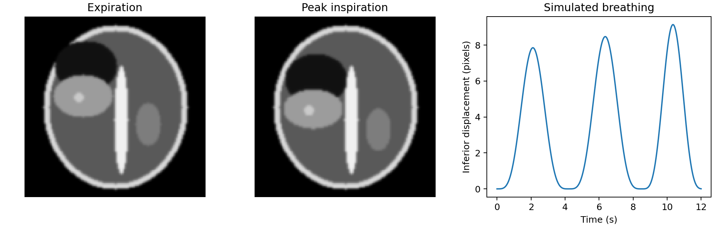
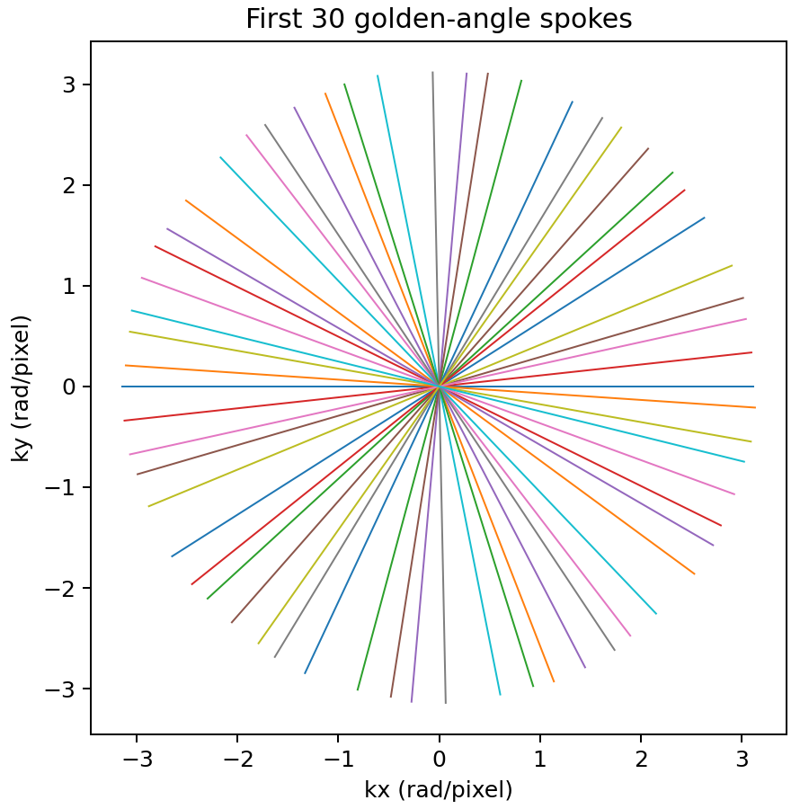
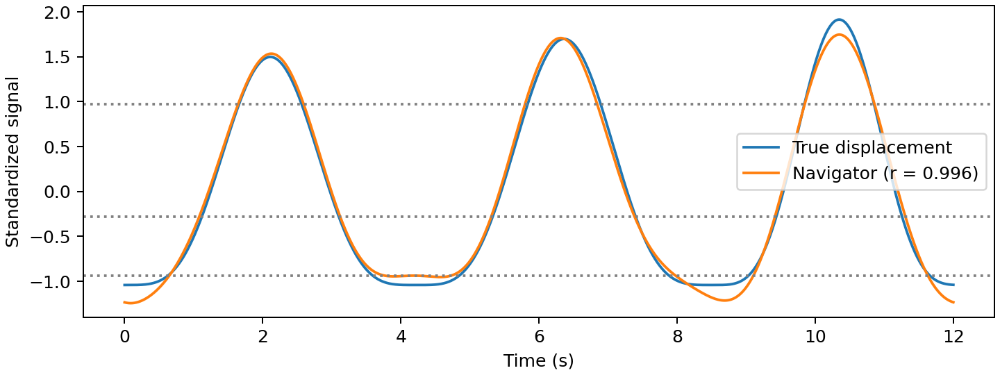
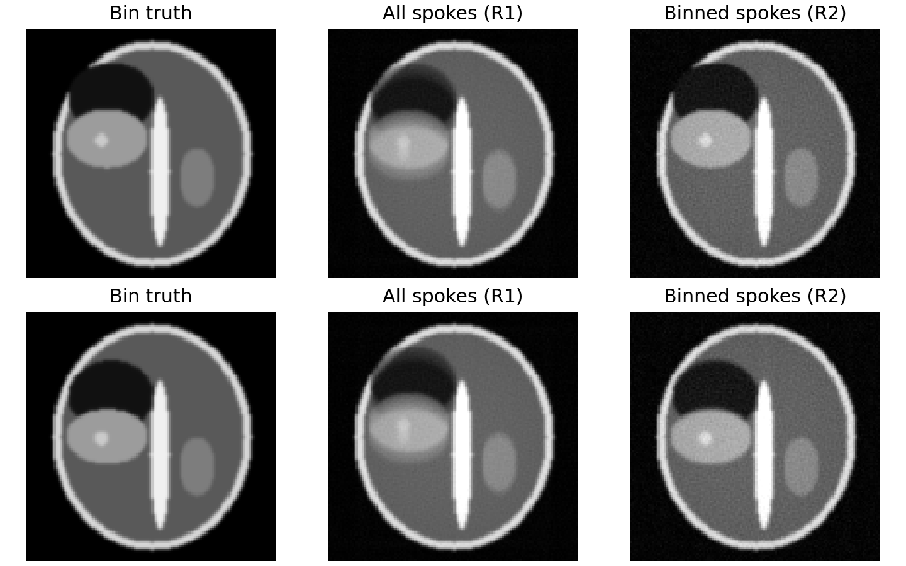

# Motion-resolved radial MRI simulation

Milestone 1 establishes a static reconstruction baseline for a free-breathing MRI simulation study. The synthetic coronal slice contains a liver, kidney, spine, lung and small liver lesion. Inspiration moves the liver and lesion inferiorly. The kidney moves 40% as far. The breathing model varies the amplitude and duration between cycles using a fixed seed.

## Milestone 1 results

| Check | Measured | Target |
| --- | ---: | ---: |
| NUFFT adjoint relative error | 8.95e-16 | < 1e-4 |
| Static gridding closure NRMSE | 3.21% | < 5% |





## Run M1

The following commands run from the repository root. The pinned versions were checked with Python 3.14.2.

```sh
python3 -m venv .venv
source .venv/bin/activate
python -m pip install -r requirements.txt
python -m unittest discover -s tests -v
python -m src.milestone1
```

The figures appear under `results/figures` as PNG and PDF. In F1, compare the liver and bright lesion between breathing extremes and check that the spine stays fixed. In F2, every spoke passes through the origin and the angles spread across the disk.

## Static reconstruction

K-space stores spatial frequencies. Each coil measures the Fourier transform of the phantom multiplied by its complex sensitivity. The synthetic sensitivities have unit summed squared magnitude at every pixel. For radial sampling, each spoke includes the zero-frequency sample. Stepping by 111.246° spreads successive spokes around the disk.

The forward operator pads each coil image, computes an orthonormal FFT, and interpolates the result at the radial coordinates. Its adjoint scatters the same interpolation weights onto the Fourier grid, applies the inverse FFT, and crops back to the image. The adjoint test checks the complex dot-product identity. The gridding baseline applies a radial density weight proportional to radius, then combines coil images with conjugate sensitivities.

On the local CPU the adjoint test gave a relative error of 8.95e-16. Static closure with 402 spokes and zero added noise gave 3.21% NRMSE after fitting one global intensity scale. This measures closure with a matched simulator and reconstruction operator. The phantom edges include 0.85-pixel Gaussian smoothing. The operator uses SciPy with bilinear interpolation on a fourfold oversampled FFT grid. TOML and standard-library unittest keep the first checkpoint runnable with the available environment.

The R3 portion of static closure belongs to M3. All data here are synthetic.

## Milestone 2: Free-breathing scan and self-navigation

Run `python -m src.milestone2` to regenerate the navigator and gridding figures.
The default scan acquires 3,000 spokes over 12 seconds. The simulator holds
the phantom fixed at the mean displacement within each 10-spoke (40 ms) chunk.
It adds independent Gaussian noise in both complex quadratures. The noise
scale targets liver SNR 30 in a separate 402-spoke static reconstruction,
using the standard deviation of the reconstructed real noise in a liver ROI.

The navigator takes the complex center sample from each spoke and coil.
It retains Fourier modes from 0.1 to 0.5 Hz and combines the filtered real and
imaginary coil traces with the first principal component. Its sign follows
the phase-aligned signal of the inferior coil for this simulated anatomy.
The short scan limits frequency resolution, and Fourier filtering assumes
a periodic extension at the scan boundaries.

The default noisy scan gives Pearson r = 0.9963 and mean bin displacements
of 0.07, 0.97, 4.15, and 7.69 pixels. Spokes are sorted by navigator
amplitude into four equal groups. The simulator
uses true displacement only to score the navigator and render the reference
image at each bin's mean displacement. R1 grids the entire acquisition.
R2 grids each group independently. The two methods share a display scale
after dividing by their respective spoke counts.





## Deep-learning prototype

This Movienet-inspired experiment refines the respiratory-binned gridding
result. It feeds the U-Net the real and imaginary parts of all eight coil
images in each of four bins. The resulting 64 input channels produce four
magnitude corrections, which are added to the sensitivity-weighted gridding
baseline. The model operates in image space. It can change a small lesion
even when the reconstruction looks cleaner.

Use the same virtual environment as above with Python 3.14 and install the
optional training dependencies:

```sh
python -m pip install -r requirements-ml.txt
python -m src.train --smoke
```

The smoke run uses two training phantoms, one validation phantom and one
held-out phantom at 32 × 32 pixels. It checks data generation, training,
checkpoint reload and evaluation. A single smoke score cannot establish
reconstruction quality.

Run `python -m src.train --epochs 12 --output runs/full` for the full-size
experiment. It generates 400 training, 50 validation and 50 test cases
using disjoint phantom seeds. It varies liver geometry and intensity, lesion
size and location, breathing and noise. The full run holds coil geometry
and spoke count fixed. It prepares cases in memory and can take substantial
CPU time. Each target is the phantom at the true mean displacement of its
navigator bin. Training uses L1 loss, and the lowest validation loss selects
the checkpoint. The output directory contains `model.pt`, `metrics.json`
with the held-out comparison against gridding, and `comparison.png` for
one held-out case. The compressed-sensing comparison and stress tests remain
separate milestones.

### Run a larger pilot on GitHub

Open **Actions → MRI U-Net pilot → Run workflow**. The pilot uses 12 training,
4 validation, and 4 test phantoms at 128 × 128 pixels, and trains for six epochs.
Download `mri-pilot-results` from the run summary for the checkpoint, held-out
mean absolute error, and comparison image. To reproduce it locally, run
`python -m src.train --pilot --epochs 6 --output runs/pilot`.
